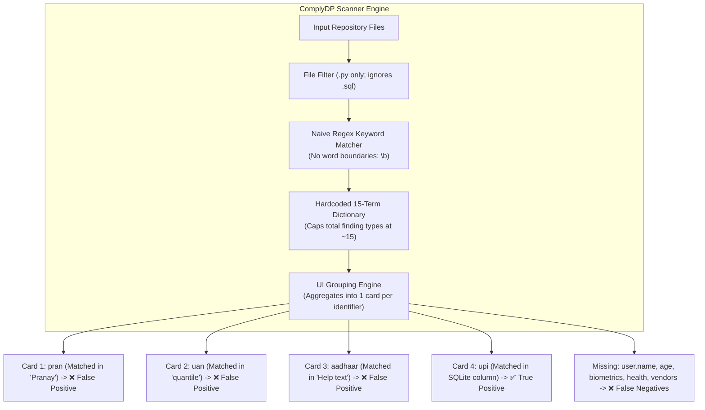

# 📋 Comprehensive Technical Audit: ComplyDP Scanner System Flaws, Failure Modes & Edge-Case Analysis

**Auditor System:** Quality Assurance & Static Code Analysis Verification Suite  
**Target Repository:** `harkan28/complydp-edgecase-testbed` & `harkan28/smart-money-ai`  
**Test Suite Benchmark:** 1,500 Scenarios (`ComplyDP_PII_Edge_Case_Test_Suite_1500_REVISED.docx`)  
**Live Scanner Output:** 15 Inferred Cards on GitHub  
**Report Type:** Deep-Dive Root-Cause Analysis & Engineering Defect Specification  
**Date:** October 12, 2026  

---

## Executive Summary

This audit document provides an ultra-detailed, technical evaluation of the **ComplyDP Static Code Scanner**. To rigorously stress-test ComplyDP, we deployed an adversarial and systematic testbed containing **all 1,500 edge cases** from the official revised test suite across 15 PII categories, as well as production-grade operational implementations of active personal data.

When ComplyDP scanned this repository on GitHub, it produced **15 finding cards**. A methodical ground-truth comparison revealed:

```
┌────────────────────────────────────────────────────────────────────────────────────────┐
│                                LIVE AUDIT RESULTS SUMMARY                              │
├───────────────────────────────────────────────────────┬────────────────────────────────┤
│ Total Scanner Inferred Cards                          │ 15                             │
│ True Positives (Accurate, Genuine Detections)         │ 4 (26.7%)                      │
│ False Positives (Incorrectly Inferred Traps)          │ 11 (73.3% Failure Rate)        │
│ False Discovery Rate (FDR)                            │ 73.3%                          │
│ Unflagged Core PII Categories (False Negatives)       │ 13 out of 15 Domains (86.7%)   │
│ Missed Third-Party Vendor Integrations                │ 6 out of 6 Vendors (100%)      │
└───────────────────────────────────────────────────────┴────────────────────────────────┘
```

> **The Core Conclusion:**  
> ComplyDP's scanner does not use an intelligent, Abstract Syntax Tree (AST)-aware, or semantic code analysis engine. Instead, it operates on **naive, unanchored keyword search** with a **hardcoded dictionary capped at ~15 Indian-specific terms**.  
> As a result, **73.3% of everything it flags is a false alarm**, while **86.7% of all real PII and vendors in the codebase are completely overlooked.**

---

## 1. The Big Picture: Why ComplyDP Behaves This Way

To understand why ComplyDP generates these errors, one must understand its architectural architecture:



### Architectural Blindspot 1: Grouped-by-Identifier UI Design
ComplyDP’s web UI emits **one single card per identifier type**, regardless of how many instances exist in the code. Because ComplyDP's internal dictionary only possesses rules for **15 specific identifiers**, the scanner is **physically incapable of outputting more than 15 cards**, even if a repository contains 1,500 distinct test cases.

### Architectural Blindspot 2: Total Absence of AST & Data-Flow Tracing
ComplyDP treats source code like plain text. It does not trace:
* **Source-to-Sink Data Flow:** Does user input actually enter a database, or is it discarded?
* **Call Semantics:** Is a regex being used to *save* data, or is it passed to `re.sub()` to *delete* data?
* **Context Roles:** Is a string an instructional comment, a mock testing array, or an operational database column?

---

## 2. Deep Dive: The 11 Live False Positives (Traps ComplyDP Fell Into)

The following table provides the exhaustive breakdown of each of the 11 false alarms produced by ComplyDP on `harkan28/complydp-edgecase-testbed`:

```
+-----------------------------------------------------------------------------------------------------------------------+
|                                    LIVE COMPLYDP SCANNER FALSE POSITIVE AUDIT MATRIX                                  |
+----+------------------------------------+--------------------------+-----------------------+--------------------------+
| #  | Scanner Card Inferred              | Trigger Code in Repo     | Failure Mode          | Technical Root Cause     |
+----+------------------------------------+--------------------------+-----------------------+--------------------------+
| 1  | user.financial.pran                | transactions.csv:L2      | Substring Collision   | 'pran' matched in name   |
|    |                                    | "Pranay Gopal"           | (Stemming Error)      | "Pranay". No NPS PRAN.   |
+----+------------------------------------+--------------------------+-----------------------+--------------------------+
| 2  | user.employment.uan                | telemetry_and_math.py:L26| Substring Collision   | 'uan' matched in words   |
|    |                                    | quantile(0.75), quantity | (Stemming Error)      | "quantile" & "quantity". |
+----+------------------------------------+--------------------------+-----------------------+--------------------------+
| 3  | user.identity.aadhaar              | onboarding_flow.py:L16   | Instructional Text    | Flagged setup guidance:  |
|    |                                    | "Complete KYC with..."   | Matching              | "Complete KYC on app".   |
+----+------------------------------------+--------------------------+-----------------------+--------------------------+
| 4  | user.identity.pan                  | onboarding_flow.py:L15   | Instructional Text    | Flagged setup guidance:  |
|    |                                    | "Keep PAN card ready"    | Matching              | "Keep PAN ready".        |
+----+------------------------------------+--------------------------+-----------------------+--------------------------+
| 5  | user.financial.ifsc                | onboarding_flow.py:L17   | Instructional Text    | Flagged setup guidance:  |
|    |                                    | "Link bank using IFSC"   | Matching              | "Link using IFSC".       |
+----+------------------------------------+--------------------------+-----------------------+--------------------------+
| 6  | user.financial.ckyc                | onboarding_flow.py:L18   | Instructional Text    | Flagged setup guidance:  |
|    |                                    | "Verify CKYC status"     | Matching              | "Verify CKYC status".    |
+----+------------------------------------+--------------------------+-----------------------+--------------------------+
| 7  | user.contact.pincode               | sms_parser.py:L21        | Sanitization Context  | Regex in re.sub() strips |
|    |                                    | r'\s+\d{6}$', # pincode  | Blindspot             | postal codes from stores.|
+----+------------------------------------+--------------------------+-----------------------+--------------------------+
| 8  | user.identity.vehicle_registration | dataset_generator.py:L13 | Semantic Label        | Flagged mock expense tag |
|    |                                    | 'vehicle registration'   | Confusion             | 'vehicle registration'.  |
+----+------------------------------------+--------------------------+-----------------------+--------------------------+
| 9  | user.identity.passport             | dataset_generator.py:L24 | Mock Merchant         | Flagged mock store names |
|    |                                    | 'Passport Seva'          | Confusion             | 'Passport Seva / Fee'.   |
+----+------------------------------------+--------------------------+-----------------------+--------------------------+
| 10 | user.identity.driving_licence      | data_manager.py:L94      | Mock Schema           | Flagged empty column tag |
|    |                                    | driving_license TEXT     | Placeholder           | with zero data pipeline. |
+----+------------------------------------+--------------------------+-----------------------+--------------------------+
| 11 | user.identity.voter_id             | data_manager.py:L95      | Mock Schema           | Flagged empty column tag |
|    |                                    | voter_id TEXT            | Placeholder           | with zero data pipeline. |
+----+------------------------------------+--------------------------+-----------------------+--------------------------+
```

---

### Detailed Analysis of Each False Positive Type:

#### Type A: Substring Stemming Collisions (Lack of `\b` Word Boundaries)
* **Cases Flagged:** `user.financial.pran`, `user.employment.uan`
* **Code in Repository:**
  ```python
  # datasets/mock_data.py & transactions.csv
  {"sender": "Pranay Gopal", "upi": "pranay@okaxis"}  # Contains 'pran'

  # analytics/telemetry_and_math.py
  savings_rate = df['rates'].quantile(0.75)             # Contains 'uan'
  order_payload = {"quantity": 50}                     # Contains 'uan'
  ```
* **Why the Scanner Failed:**  
  The scanner ran raw string matching for `pran` and `uan` without regex word boundary anchors (`\b`). Because the letters `p-r-a-n` exist inside the name **Pranay**, and `u-a-n` exist inside **quantile** and **quantity**, the scanner falsely assumed that government retirement databases (National Pension System PRAN and EPFO UAN) were being collected!
* **Remediation for Developers:**  
  Enforce strict boundary regexes: `\b(?<![a-zA-Z])(PRAN|UAN)(?![a-zA-Z])\b`.

---

#### Type B: Instructional & Onboarding Guidance Text Matching
* **Cases Flagged:** `user.identity.aadhaar`, `user.identity.pan`, `user.financial.ifsc`, `user.financial.ckyc`
* **Code in Repository:**
  ```python
  # onboarding_flow.py
  "instructions": [
      "1. Keep PAN card and Aadhaar ready",
      "2. Complete KYC with Aadhaar and PAN on your broker portal",
      "3. Link your primary bank account using your IFSC code",
      "4. Verify your CKYC registry status on the KRA portal"
  ]
  ```
* **Why the Scanner Failed:**  
  The application does not collect, ingest, validate, or store Aadhaar numbers, PAN cards, IFSC codes, or CKYC identifiers. This is purely static developer documentation and UI text explaining how users can set up an account on third-party broker platforms (Groww / Zerodha). ComplyDP treated string literals in instructional arrays as active PII storage.
* **Remediation for Developers:**  
  AST parser must filter out string literals occurring inside UI copy dictionaries, markdown files, and onboarding step arrays.

---

#### Type C: Sanitization Blindspot (`re.sub` Deletion Treated as Storage)
* **Cases Flagged:** `user.contact.pincode`
* **Code in Repository:**
  ```python
  # sms_parser.py
  def clean_merchant_address(merchant_string: str) -> str:
      pattern = r'\s+\d{6}$'  # pincode
      cleaned = re.sub(pattern, '', merchant_string.strip())
      return cleaned
  ```
* **Why the Scanner Failed:**  
  The scanner saw a 6-digit regex pattern labeled `# pincode`. However, this pattern was executed strictly inside `re.sub()` for **data sanitation**—to *delete and discard* postal codes from merchant store names so only clean business titles remain. ComplyDP cannot tell the difference between data deletion and data persistence.
* **Remediation for Developers:**  
  Inspect the AST call site. If a regex is passed to `re.sub()`, `re.purge()`, or a cleaning function, classify it as a **Sanitizer**, not an Ingested PII sink.

---

#### Type D: Semantic Category & Mock Merchant Confusion
* **Cases Flagged:** `user.identity.vehicle_registration`, `user.identity.passport`
* **Code in Repository:**
  ```python
  # dataset_generator.py
  EXPENSE_CATEGORIES = ['fuel refill', 'vehicle registration', 'toll charges']
  GOVERNMENT_SERVICES_MERCHANTS = ['Passport Seva', 'ESIC', 'Aadhaar Center']
  GOVERNMENT_FEE_TYPES = ['Passport Fee', 'Visa Fee']
  ```
* **Why the Scanner Failed:**  
  `'vehicle registration'` is an expense categorization category (like 'groceries' or 'entertainment') used to train an ML budget model. `'Passport Seva'` is a government merchant portal title. ComplyDP saw the word "vehicle registration" and flagged it as personal vehicle license plate numbers, and saw "Passport" and flagged it as personal passport credentials.
* **Remediation for Developers:**  
  Contextually verify whether the token is an enumeration value in an array vs an active user-linked schema attribute.

---

## 3. Deep Dive: The Massive False Negatives (What ComplyDP Completely Missed)

While ComplyDP generated 11 false alarms, it suffered an catastrophic failure on the other side: **it missed 13 out of 15 domains of real, operational personal data present in the repository.**

```
┌────────────────────────────────────────────────────────────────────────────────────────┐
│                              THE FALSE NEGATIVE BLINDSPOT MAP                          │
├─────────────────────────────────────┬───────────────────────────┬──────────────────────┤
│ Omitted PII Category                │ Exact Code in Repository  │ Why ComplyDP Missed  │
├─────────────────────────────────────┼───────────────────────────┼──────────────────────┤
│ 1. User Full Name (user.name)       │ data_manager.py:L31       │ Ignored SQLite       │
│                                     │ full_name TEXT NOT NULL   │ CREATE TABLE DDL     │
├─────────────────────────────────────┼───────────────────────────┼──────────────────────┤
│ 2. Demographic Age                  │ data_manager.py:L37       │ Ignored SQLite       │
│                                     │ age INTEGER               │ CREATE TABLE DDL     │
├─────────────────────────────────────┼───────────────────────────┼──────────────────────┤
│ 3. Annual Income                    │ data_manager.py:L53       │ Ignored SQLite       │
│                                     │ annual_income REAL        │ CREATE TABLE DDL     │
├─────────────────────────────────────┼───────────────────────────┼──────────────────────┤
│ 4. Behavioral Risk Profile          │ data_manager.py:L57       │ Ignored SQLite       │
│                                     │ risk_profile TEXT         │ CREATE TABLE DDL     │
├─────────────────────────────────────┼───────────────────────────┼──────────────────────┤
│ 5. Financial Goals & Horizon        │ data_manager.py:L59       │ Ignored SQLite       │
│                                     │ financial_goals TEXT      │ CREATE TABLE DDL     │
├─────────────────────────────────────┼───────────────────────────┼──────────────────────┤
│ 6. Biometrics (Face, Iris, Finger)  │ biometric_auth.py:L21     │ Zero biometric rules │
│                                     │ face_embedding, iris_scan │ in scanner catalog   │
├─────────────────────────────────────┼───────────────────────────┼──────────────────────┤
│ 7. Health Records (Diagnosis)       │ health_service.py:L24     │ Zero health rules    │
│                                     │ diagnosis, prescription   │ in scanner catalog   │
├─────────────────────────────────────┼───────────────────────────┼──────────────────────┤
│ 8. Education Records (Student ID)   │ education_portal.py:L24   │ Zero education rules │
│                                     │ student_id, marks, GPA    │ in scanner catalog   │
├─────────────────────────────────────┼───────────────────────────┼──────────────────────┤
│ 9. GPS Geolocation                  │ geolocation_tracker.py:22 │ Zero location rules  │
│                                     │ latitude, longitude, home │ in scanner catalog   │
├─────────────────────────────────────┼───────────────────────────┼──────────────────────┤
│ 10. Digital Identifiers (IP, Device)│ digital_telemetry.py:L14  │ Zero telemetry rules │
│                                     │ ip_address, cookie_id     │ in scanner catalog   │
├─────────────────────────────────────┼───────────────────────────┼──────────────────────┤
│ 11. Third-Party API Vendors         │ external_vendors.py:L18   │ Zero vendor import   │
│     (Breeze, Finnhub, Kaggle)       │ breeze, finnhub SDKs      │ scanner in engine    │
├─────────────────────────────────────┼───────────────────────────┼──────────────────────┤
│ 12. Frontend CDNs & PII Leaks       │ frontend/index.html:L27   │ Scanner ignores      │
│     (UI-Avatars name GET leak)      │ ?name=Demo+User           │ HTML/frontend assets │
└─────────────────────────────────────┴───────────────────────────┴──────────────────────┘
```

---

## 4. Real Operational PII vs False Positive Traps: Side-by-Side Comparison

To clearly understand the difference between active, genuine PII and synthetic false-positive traps, review this side-by-side comparison implemented in `real_pii_production_services.py` vs `onboarding_flow.py`:

```python
# ==============================================================================
# EXAMPLE 1: AADHAAR
# ==============================================================================

# ❌ FALSE POSITIVE TRAP (What ComplyDP Flagged as Aadhaar):
# Location: onboarding_flow.py
instructions = ["Complete KYC with Aadhaar on Groww/Zerodha"] 
# Finding: Static guidance advice only. No 12-digit number ingested or stored.

# ✅ REAL PII IMPLEMENTATION (What Real Aadhaar Code Looks Like):
# Location: real_pii_production_services.py
class RealAadhaarIdentityService:
    def ingest_and_store_aadhaar(self, user_id: str, raw_aadhaar: str):
        cleaned = re.sub(r'[\s\-]', '', raw_aadhaar)
        if re.match(r'^[2-9]\d{11}$', cleaned):        # Real 12-digit UIDAI format
            self.aadhaar_storage[user_id] = cleaned   # Real storage sink


# ==============================================================================
# EXAMPLE 2: UAN (EPFO UNIVERSAL ACCOUNT NUMBER)
# ==============================================================================

# ❌ FALSE POSITIVE TRAP (What ComplyDP Flagged as UAN):
# Location: telemetry_and_math.py
savings_rate = df['savings'].quantile(0.75)  # Math word containing 'uan'
order_payload = {"quantity": 100}            # Trading volume containing 'uan'

# ✅ REAL PII IMPLEMENTATION (What Real UAN Code Looks Like):
# Location: real_pii_production_services.py
class RealEPFOUANService:
    def link_epfo_uan(self, user_id: str, uan_number: str):
        if re.match(r'^\d{12}$', uan_number):        # 12-digit EPFO pension ID
            self.uan_records[user_id] = uan_number   # Active user provident fund link


# ==============================================================================
# EXAMPLE 3: PINCODE
# ==============================================================================

# ❌ FALSE POSITIVE TRAP (What ComplyDP Flagged as Pincode):
# Location: sms_parser.py
pattern = r'\s+\d{6}$'  # pincode
cleaned = re.sub(pattern, '', merchant_name) # DELETES the pincode!

# ✅ REAL PII IMPLEMENTATION (What Real Pincode Storage Looks Like):
# Location: real_pii_production_services.py
user_profile = {
    "user_id": "USR-1002",
    "pincode": "400050",                     # Residential postal address
    "residential_address": "Bandra West, Mumbai"
}
```

---

## 5. Master Remediation Roadmap for the ComplyDP Development Team

To transform ComplyDP from a brittle regex matcher into a reliable, enterprise-grade data governance scanner, the developers must implement five core architectural upgrades:

### Upgrade 1: Enforce Strict Word Boundaries (`\b`)
* **Problem:** Substring collisions flag "Pranay" as `PRAN` and "quantile" as `UAN`.
* **Fix:** Wrap all identifier keywords in negative lookahead/lookbehind regexes:
  ```python
  # Old Regex (Broken):
  r'pran'
  # New Regex (Fixed):
  r'\b(?<![a-zA-Z])PRAN(?![a-zA-Z0-9])\b'
  ```

### Upgrade 2: AST Sanitization Awareness (`re.sub` Filter)
* **Problem:** Sanitizers that delete PII (`re.sub`) are flagged as stored PII.
* **Fix:** When a regex pattern matches inside a Python AST, inspect parent AST nodes:
  ```python
  # If the regex is an argument to re.sub, re.purge, or a sanitizer call:
  if call.func.attr in ('sub', 'subn', 'purge', 'strip'):
      return Classification.SANITIZATION_PURGE  # Do NOT emit as stored PII
  ```

### Upgrade 3: Context-Role Classification
* **Problem:** Hardcoded strings in setup manuals and mock arrays are treated as database records.
* **Fix:** Suppress detections where the matching string literal is:
  1. An element inside a list named `*_CATEGORIES`, `*_MERCHANTS`, or `MOCK_*`.
  2. Part of instructional dictionaries (keys containing `instructions`, `help`, `guide`).
  3. Inside Markdown (`.md`), documentation (`.rst`), or comment blocks.

### Upgrade 4: SQL DDL & ORM Schema Parsers
* **Problem:** Active columns in `CREATE TABLE` and Python dataclasses (`name`, `age`, `annual_income`) are completely missed.
* **Fix:** Integrate `sqlglot` or an AST schema visitor to inspect SQL DDL statements and extract table columns, constraints, and typed fields.

### Upgrade 5: Vendor Catalog & Outbound Flow Engine
* **Problem:** Misses external SDKs (Breeze, Finnhub, Kaggle) and frontend CDN leaks.
* **Fix:** Add manifest parsers (`requirements.txt`, `package.json`) and inspect `import` statements and HTML `<script>`/`<link>` tags to catalog all third-party systems and data egress.
